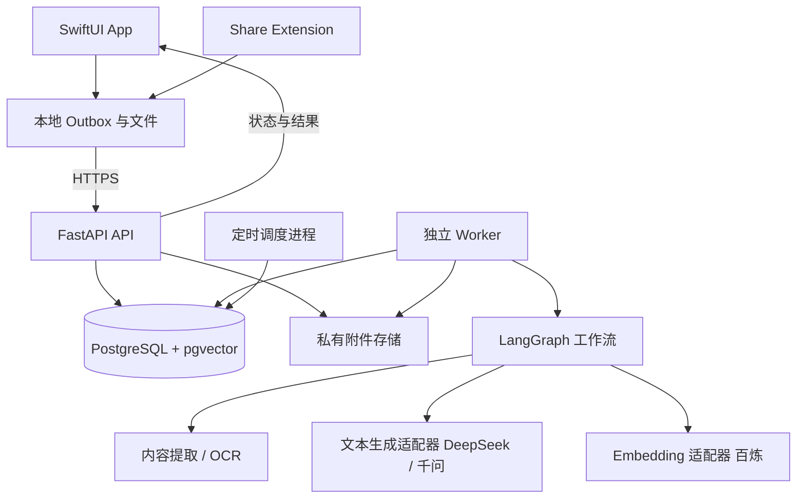

# Gatherloom｜项目驱动的个人知识库完整方案

> 版本：v1.2 · 开发前产品与技术基线（v1.1 + 2026-11-09 技术决策细化）  
> 整理日期：2026-11-07（Asia/Shanghai）  
> 技术路线：SwiftUI + 自建项目模型 + Python/FastAPI + LangGraph + PostgreSQL/pgvector  
> 首版支持多个独立账号，账号之间数据隔离；暂不引入 Pi Agent SDK。  
> 本文件是实施方案，尚未创建应用代码、部署服务或实测模型效果。标记为“默认设计”的内容是为推进开发提出的方案，可在对应阶段调整。

## v1.2 变更摘要

2026-11-09 经评估与确认，以下决策覆盖正文中对应的默认设计，详见 [docs/decisions/](decisions/)，分阶段任务见 [roadmap.md](roadmap.md)。

| ADR | 决策 |
|---|---|
| [0001](decisions/0001-embedding-bailian-qwen.md) | Embedding 使用阿里云百炼 `qwen3.7-text-embedding-flash`（国际站） |
| [0002](decisions/0002-llm-routing-by-task.md) | 文本生成按任务分流，DeepSeek / 千问均可配置 |
| [0003](decisions/0003-ocr-on-device-vision.md) | 截图 OCR 以 iOS 端侧 Vision 为主，服务端 Tesseract 兜底 |
| [0004](decisions/0004-web-extraction-safari-preprocessing.md) | 网页正文优先由 Safari 分享扩展 JS 预处理获取，服务端抓取补充 |
| [0005](decisions/0005-chinese-keyword-search-jieba.md) | 中文关键词检索采用应用侧 jieba 分词 + `simple` tsvector |
| [0009](decisions/0009-knowledge-card-retrieval-augmentation.md) | 知识卡片作为派生检索单元；上下文 chunk 头与卡片路默认启用，其余增强按评测启用 |
| [0006](decisions/0006-orchestration-langgraph-checkpointer.md) | 保持 LangGraph + PostgreSQL checkpointer，删除流程显式清理检查点 |
| [0007](decisions/0007-deployment-overseas-server.md) | 服务器位于海外/港澳，无需 ICP 备案 |
| [0008](decisions/0008-apple-signing-free-team.md) | 暂用免费签名开发，内测前购买 Apple 开发者账号 |

首版 P0 范围不缩减，按 roadmap 细化步骤推进。

## 1. 产品定位

### 1.1 一句话介绍

在 iPhone 上随手收集资料与想法，由服务器自动整理、关联并更新项目认识，让用户围绕具体项目找到依据、确认决定、持续回顾。

核心承诺：**随手记录，有据可查，持续推进项目。**

### 1.2 目标用户与使用场景

首批用户为开发者、独立创作者和有明确学习目标的人。先服务开发者本人，再邀请少量用户独立使用。

典型项目包括：开发一个 App、研究一项技术、完成一门课程、为一次创作积累材料。第一版用“开发一个个人知识库 App”作为演示项目。

用户在项目过程中不断遇到文章、截图和灵感，但资料与正在解决的问题、最终作出的决定之间缺少连接。本产品围绕这些连接组织知识。

### 1.3 项目驱动的含义

一个项目包含目标、待解问题、资料、个人想法、决定和阶段回顾。项目首页要能回答：

1. 我希望完成什么？
2. 现在最需要弄清楚什么？
3. 最近增加了哪些有用证据？
4. 我已经决定了什么，依据是什么？
5. 相比上一阶段，我的认识有什么变化？

资料允许被同一用户的多个项目复用。首版的关联推荐与问答限定在当前项目；全局搜索限定在当前账号。

### 1.4 首版成功的标志

连续推进一个真实项目时，用户愿意每天记录，能在几天后找到原来的依据，并能借助回顾看清认识和决定的变化。

衡量重点是可靠收集、有效找回与项目推进；资料数量、聊天次数作为辅助指标。

### 1.5 项目命名与 GitHub 仓库约定

| 项目 | 约定 |
|---|---|
| 英文项目名 / App 展示名 | **Gatherloom** |
| GitHub 仓库名 | `gatherloom` |
| 中文展示名 | 知织（暂定） |
| 中文介绍 | 围绕项目，收集想法、连接资料、沉淀有据可查的认识。 |
| GitHub Description | A project-driven personal knowledge workspace with iOS capture, source-grounded answers, and continuous reflection. |
| Slogan | Gather ideas. Weave understanding. |

`Gather` 表示收集资料与想法，`Loom` 表示织机，寓意把零散内容织成围绕项目持续积累的知识。名称覆盖采集、关联、问答和回顾，也为后续扩展保留空间。

备选名称记录：`ProjectWeft`（项目的知识织线，定位明确但 weft 较生僻）、`Clueward`（沿线索向前推进，容易联想到解谜产品）。当前采用 Gatherloom。

2026-11-07 的 [GitHub 公开仓库名称查询](https://api.github.com/search/repositories?q=gatherloom%20in%3Aname)未返回包含 `gatherloom` 的仓库。这是查询时的公开搜索结果，不代表名称已被保留；本方案尚未创建 GitHub 仓库。

采用单仓库，根目录使用 `gatherloom/`，内部按 `ios/`、`server/`、`docs/`、`deploy/` 等目录组织，具体结构见第 13 节。

## 2. 已确认需求与默认设计

### 2.1 用户已确认

| 维度 | 已确认选择 |
|---|---|
| 项目命名 | Gatherloom；GitHub 仓库名 `gatherloom`；中文名“知织”暂定 |
| 产品组织方式 | 按项目驱动，兼收外部资料与个人想法 |
| App 启动页 | 快速记录，旁边展示最近项目 |
| 系统分享 | 默认进入收集箱，也可直接选择项目 |
| 提交后的体验 | 立即反馈保存情况，后台处理，之后查看摘要与关联 |
| 项目首页 | 目标、待解问题、最近动态、最新回顾 |
| AI 权限 | 自动更新项目总结并保留历史；正式决定由用户确认 |
| 决定入口 | AI 主动生成决定草稿，用户在待确认列表中处理 |
| 问答 | 项目内问答为主；全局搜索；跨项目问答延后 |
| 总结与回顾 | 新内容处理后合并更新总结；每周有变化时自动回顾，也可手动生成 |
| 账号 | 第一版支持多个独立账号，数据相互隔离 |
| 部署与模型 | 已有服务器；已有 DeepSeek API，可更换服务商 |
| Agent SDK | 首版不加入 Pi Agent SDK |

### 2.2 本方案采用的默认设计

| 尚未明确的事项 | 默认方案 |
|---|---|
| 首版语言 | 简体中文，保留中英混合资料检索能力 |
| iOS 最低版本 | 暂定 iOS 17；S0 阶段核对用户设备与 Xcode 条件 |
| 快速记录默认归属 | 全局进入时默认收集箱；从项目内进入时预选当前项目；不记忆其他项目作为隐式归属 |
| 注册 | 邀请码注册，多个私人账号；没有团队空间和共享项目 |
| 对外访问 | 现有服务器部署 HTTPS API；域名、网络和系统条件在 S0 核对 |
| 周回顾 | 用户时区每周一 09:00，为上一自然周生成；初始时区 Asia/Shanghai |
| 通知 | App 内未读标记；首版不依赖 APNs |
| 离线 | 支持新增记录排队上传；在线编辑已有记录 |
| 文件 | 单条记录支持文字、一个 URL 或一张图片，均可附个人备注 |
| 每周投入、SwiftUI 经验 | 未提供；计划按阶段和有效工作量估算，不承诺固定完成日期 |

服务器规格、具体生成模型 ID、模型预算上限列为 S0 核对项。此前不假设服务器具备 GPU。Embedding 服务商已定为百炼（ADR 0001）；签名条件见 ADR 0008。

## 3. 产品信息架构与交互

### 3.1 导航结构

底部四个入口：**记录 / 收集箱 / 项目 / 搜索**。默认打开“记录”。设置从个人头像进入。

```text
记录（默认首页）
 ├─ 输入文字 / 粘贴链接 / 选择截图
 ├─ 可选个人备注
 ├─ 最近项目快捷选择
 └─ 保存

收集箱
 ├─ 未归属资料
 ├─ 上传或处理异常
 └─ 分配项目 / 查看详情

项目
 └─ 项目概览
     ├─ 目标与 AI 当前总结
     ├─ 待解问题
     ├─ 最近动态
     ├─ 待确认决定
     ├─ 最新回顾
     └─ 资料 / 问答 / 决定 / 回顾历史

搜索
 ├─ 当前账号内全局搜索
 ├─ 项目、类型、时间筛选
 └─ 打开资料及其项目入口
```

### 3.2 快速记录

- 输入优先，不要求先分类或填写标题。
- 文字记录默认为“个人想法”；链接或图片默认为“外部资料”，类型可手动更正。
- 外部资料的个人备注单独保存，界面明确区分“资料内容”和“我的备注”。
- 项目选择是可选项；显示明确的“收集箱”或项目名称，避免用户误判归属。
- 最近项目按用户最近访问或保存记录的时间展示，最多三个。
- 保存成功后清空输入，保持在记录页，并提供“查看记录”入口。
- 首版一个提交保存一个主输入。收到多附件分享时提示选择一项，不静默丢弃其他项。

### 3.3 系统分享扩展

分享面板展示内容预览、可选备注、归属选择和保存按钮。默认归属为收集箱。

扩展先将提交内容写入 App Group 共享待上传目录，再尝试后台上传；不等待正文解析或 AI 返回。扩展与主 App 共用账号凭证访问组，任务绑定提交时的账号 ID。

未登录、凭证过期或网络不可用时：保留本地提交，提示打开 App 完成登录或上传。系统后台运行受 iOS 调度、设备与用户操作影响，不能保证关掉 App 后立即上传；主 App 下次进入前台必须继续处理队列。

Apple 的后台传输要求与共享容器机制见[官方说明](https://developer.apple.com/library/archive/documentation/General/Conceptual/ExtensibilityPG/ExtensionScenarios.html)。

### 3.4 保存状态文案

| 状态 | 用户看到的文案 | 确切含义 |
|---|---|---|
| 本地提交成功 | 已存到本机，等待上传 | 文件和提交清单已持久化，服务器尚未确认 |
| 正在上传 | 正在上传 | 传输尚未完成 |
| 服务端接收成功 | 已保存到服务器，正在整理 | 原始内容已可靠保存，处理任务已登记 |
| 检索索引完成 | 已可检索 | 该版本已完成索引；AI 关联等增强结果可能仍在处理 |
| 增强结果完成 | 整理完成 | 本条摘要、关联处理已结束；项目总结另有更新时间 |
| 部分失败 | 已保存，部分整理失败 | 原始内容保留，显示失败步骤及重试入口 |

“立即保存”描述本地持久化体验，不提前承诺服务器已收到。

### 3.5 收集箱与资料详情

收集箱默认展示尚未关联任何项目、且未被用户归档的资料。分配到至少一个项目后退出默认列表；仍可在全局搜索中找回。

资料详情展示：原始内容、来源 URL、收藏时间、个人备注、提取正文或 OCR 文本、知识卡片（AI 标题、摘要、要点、关键词，标注“AI 整理”）、所属项目、关联建议、处理状态。

支持：编辑个人内容或备注、修正 OCR、加入或移出项目、重试失败步骤、删除。编辑生成新版本，旧引用仍能识别其原版本。外部原始材料保留，正文或 OCR 修正另记为新加工版本。

### 3.6 项目概览

从上到下：

1. 项目名称、状态、用户定义的目标。
2. AI 当前总结：当前认识、重要依据、不确定项；标明更新时间、处理覆盖和历史入口。
3. 待解问题：可手动增加、编辑、标记解决或重新打开。
4. 待确认决定：有数量标记，进入草稿列表。
5. 最新阶段回顾与最近动态。
6. 资料、问答、正式决定和回顾历史入口。

用户目标不会被 AI 自动修改。AI 总结是自动维护的认识草稿；问题是否解决由用户操作确认。

### 3.7 关联建议

首版只做同项目内两种关系：“相关资料”“与待解问题相关”。单条资料最多展示三个建议，每条附一句理由和来源入口。

建议状态为 suggested / accepted / dismissed。用户接受后保存为显式关系；忽略后，相同资料版本与目标的建议不重复出现。资料分配到项目本身是用户动作，不由关联模型偷偷改变。

### 3.8 决定草稿

AI 可在新资料、问答或总结中发现明确的选项与倾向后，生成决定建议。不能把模型自己的建议表述成“用户已决定”。没有足够依据时不生成。

草稿字段：标题、建议选择、理由、备选项、依据引用、适用前提。用户可编辑后确认、拒绝或暂不处理。

- 只有用户点击确认才写入正式决定，并记录确认时间和当时的文本。
- 正式决定修改产生修订，不覆盖历史；可以标记被后续决定替代。
- 确认决定只保存知识记录，不执行外部操作。
- 默认每项目每天最多生成三个新草稿；按规范化主题与来源指纹去重。上线后根据使用数据调整。
- 待确认列表区分“新草稿”和“依据已变化”；拒绝后的相同草稿不反复生成。

## 4. 六条核心流程

### 4.1 采集与入库

```text
iPhone / 分享扩展
 → 本地持久化提交（client_submission_id、owner_id）
 → 上传
 → 服务端验证账号与项目权限
 → 保存原始资料、版本及后台任务
 → 确认服务器已保存
 → Worker 执行提取、摘要、索引、关联建议
 → 回传可检索与处理状态
```

同一账号的同一 submission_id 重试返回同一记录，不重复创建。内容相同但 submission_id 不同的提交只提示可能重复，不自动合并用户备注。

### 4.2 从收集箱加入项目

选择资料 → 选择项目 → 验证同账号所有权 → 建立关联 → 加入项目检索范围 → 排队更新总结与关联建议。

已处理资料不必重新 OCR 或向量化。移出项目立即停止该项目的新检索命中，触发总结更新，保留该账号的原始资料。

### 4.3 自动维护项目总结

原始资料就绪、归属变化、问题更新、正式决定变化等事件，把项目标记为待更新。默认合并两分钟内的事件，单项目更新串行执行。

总结输入包括用户目标、问题、正式决定、上一总结、期间变化和检索出的相关证据。每次发布保存版本、来源清单、输入水位和简短变化说明。

AI 生成的摘要、关联、总结本身不再次触发总结，防止无限循环。生成期间又发生新变化时，旧任务不能把更新标记清除；继续排队处理后续水位。

UI 显示“基于截至某时间的已处理内容”。失败或超出本轮上下文预算时明确显示部分覆盖，不声称审阅了所有资料。

### 4.4 项目内有来源的问答

进入项目问答 → 保存问题 → 校验当前项目 → 项目范围内混合检索 → 读取证据 → 生成回答 → 保存答案、引用及检索记录。

- 多轮会话保留上下文，但每次检索都重新执行账号和项目过滤。
- 回答使用可点击编号引用，打开原记录的对应片段。
- 区分外部证据、个人记录与 AI 推断；引用个人记录时标注其身份。
- 当前总结可作导航上下文，关键事实优先引用原始记录与正式决定。
- 无足够资料时说明信息不足；首版不自动联网补充。
- 首版先实现一次检索后回答。S4 验证需要时，增加至多两轮检索，不运行无限 Agent 循环。
- 初始实现保存完整结果后显示；流式显示可以随后加入，但只有持久化后的完整回答才标记完成。

### 4.5 确认决定

收到草稿 → 查看理由和引用 → 编辑 → 确认 / 拒绝 / 稍后 → 正式决定入库 → 标记项目总结待更新。

若确认前来源已经修改或删除，显示依据变化，要求用户重新检查；不在后台自动确认。

### 4.6 持续回顾

每周一按账号时区扫描上一自然周。有原始资料、归属、问题或正式决定变化的活跃项目才生成回顾；仅 AI 派生物更新不算新增活动。

回顾结构：本期新增信息、认识变化、正式决定、未解决问题、下一阶段建议。重要内容附来源；“下一步”标记为建议。

- 手动生成默认覆盖上次回顾结束至当前时间；首次覆盖项目创建至今。
- 自动周期唯一键防止重复发布；同一周期重试不生成重复卡片。
- 新回顾标记未读；打开后已读，不主动推送到系统通知。
- 总结描述当前认识；回顾保留特定时间段的历史，不被最新总结覆盖。
- 资料后来被删除时，历史回顾保留日期与失效标记，清除相应引用中的已删除正文，后续问答不得继续使用。

## 5. MVP 范围与优先级

### 5.1 P0：MVP 交付必须具备

| 模块 | 首版范围 |
|---|---|
| 账号 | 邀请注册、登录、会话刷新与退出、账号隔离 |
| 项目 | 目标、active/archived、待解问题、概览 |
| 输入 | 文字、链接、单张截图、个人备注、系统分享 |
| 可靠采集 | 本地队列、前台恢复上传、幂等提交、处理状态、失败重试 |
| 整理 | 网页正文提取、CPU 截图 OCR、自动标题和摘要 |
| 检索 | 账号内全局搜索；项目过滤；中文关键词与语义混合检索 |
| 关联 | 同项目相关资料与问题建议，接受或忽略 |
| 总结 | 自动合并更新、来源、更新时间、历史版本 |
| 问答 | 项目内会话、带来源回答、信息不足表达 |
| 决定 | AI 草稿、待确认列表、编辑确认、正式决定历史 |
| 回顾 | 每周按变化自动生成、手动生成、未读状态 |
| 运维 | HTTPS、备份恢复、模型用量记录、按用户配额与基本限流 |
| 数据生命周期 | 编辑版本、删除、归属变化对索引和派生结果的影响 |

P0 内部也分阶段上线，不要求第一天同时完成。多账号隔离和可靠保存不能留到最后补做。

### 5.2 P1：MVP 后再评估

语音输入与转写、PDF、批量收集、跨项目问答、跨项目关联、总结人工批注、完整 Markdown/JSON 导出、APNs、用户自助密码找回、多设备离线编辑。

### 5.3 首版边界

首版不建设共享项目、企业权限、付费系统、知识图谱数据库、通用富文本编辑器、公开知识库发布、自主全网研究、浏览器登录抓取、远程 shell 或 Coding Agent 执行环境。

Pi Agent SDK、Graphiti、LightRAG 和额外记忆框架暂不进入依赖。noah-dev 保持为另一个项目。

## 6. 技术架构

### 6.1 部署结构



单仓库组织，服务端采用模块化单体。API、Worker、Scheduler 可使用同一镜像的不同启动命令，独立进程运行；不把长任务放在 HTTP 请求结束后的临时内存任务里。

### 6.2 技术选择

| 层 | 推荐实现 | 边界 |
|---|---|---|
| iOS | SwiftUI、Swift Concurrency、URLSession | 原生界面、网络、异步状态 |
| 本地缓存 | SwiftData | 已同步内容和界面缓存，不承担服务端业务真相 |
| 跨扩展提交 | App Group 独立文件与原子清单 | 避免两套进程同时写同一个业务缓存；后台传输从文件上传 |
| 凭证 | Keychain + 共享访问组 | 按账号保存，扩展可读取当前会话 |
| API | Python、FastAPI、Pydantic | 参数校验、认证、权限、领域服务 |
| 数据访问 | SQLAlchemy + Alembic | 数据模型、事务与迁移 |
| 持久化 | PostgreSQL + pgvector | 业务数据、检索、任务元数据 |
| 编排 | LangGraph + PostgreSQL checkpointer | 步骤状态、分支、恢复 |
| 任务调度 | PostgreSQL 任务表 + 独立 Worker | 认领租约、重试、并发与幂等 |
| 附件 | Storage 接口；先用服务器私有卷 | 仅认证 API 返回，后续可换私有对象存储 |
| 网页提取 | Safari 分享扩展 JS 预处理取已渲染正文为主；Python HTTP 客户端 + 正文提取器补充 | 见 ADR 0004；失败可补充正文 |
| 中文分词 | jieba（应用侧）+ PostgreSQL `simple` 全文配置 | 见 ADR 0005 |
| OCR | iOS Vision 端侧识别（zh-Hans、en-US）为主；服务端 CPU Tesseract 兜底 | 端侧结果作为 `client_ocr` 加工版本上传；见 ADR 0003 |
| 部署 | Docker Compose + HTTPS 反向代理 | 复用现有服务器，规格确认后设置资源与并发 |

依赖在 S0 固定兼容版本和锁文件，不在生产使用浮动 latest。FastAPI 部署模型见[官方说明](https://fastapi.tiangolo.com/deployment/concepts/)。Tesseract 语言数据见[官方仓库](https://github.com/tesseract-ocr/tessdata_fast)。这些是候选实现，不代表中文效果已实测通过。

### 6.3 生成、Embedding 与 OCR 分别配置

**文本生成：**按任务分流（ADR 0002）：轻任务（标题、摘要、关联理由）用低成本模型，重任务（问答、总结、决定草稿、回顾）用强模型；DeepSeek 与百炼千问均通过同一 Provider 接口配置。具体模型 ID 通过开发时的可用模型列表及小样本测试选择，不在方案中依赖可能变化的别名。

**Embedding：**单独配置 Provider、模型、维度及版本。已选定阿里云百炼 `qwen3.7-text-embedding-flash`（ADR 0001），服务器在海外，使用国际站端点；S0 核对该模型在国际站的可用性、维度、批量上限、费用与中文召回后锁定为 index_version=1。[DeepSeek 模型元数据](https://api-docs.deepseek.com/api/list-models/)、[百炼 Embedding 文档](https://www.alibabacloud.com/help/en/model-studio/embedding)。

**OCR：**iOS 端侧 Vision 识别后随图片上传；客户端未提供文字时由服务器 Tesseract 适配器兜底。失败保留图片并可手动补充文字；不要求生成模型提供图片理解能力。

模型调用保留运行 ID、Provider、模型、提示词版本、用量和结果版本。结构化输出经过 Pydantic 校验；即使接口输出合法 JSON，也检查字段、来源 ID 与业务状态。格式错误最多额外修复一次，再失败则记录错误，不污染业务表。[DeepSeek JSON 输出说明](https://api-docs.deepseek.com/guides/json_mode/)。

生成模型可以更换而不必重建向量；Embedding 模型变更必须新建索引版本、回填并验证后切换，不混用不同向量空间。

### 6.4 LangGraph 的三条工作流

| 图 | 输入 | 主要节点 | 输出 |
|---|---|---|---|
| EntryIngestionGraph | owner、entry、revision、run | 提取 → 生成摘要 → 分块与索引 → 关联建议 | 可检索状态、派生物、后续项目事件 |
| ProjectMaintenanceGraph | owner、project、目标事件水位、任务类型 | 读取项目与证据 → 总结 / 决定建议 / 回顾 → 校验 → 发布 | 总结新版本、决定草稿或回顾 |
| ProjectAnswerGraph | owner、project、conversation、question | 校验范围 → 检索 → 整理证据 → 回答 → 引用校验 | 持久化回答、引用、检索跟踪 |

同一个图可以按任务类型走不同分支。共同依赖领域服务，不在图节点中散落权限判断或直接拼接数据库查询。

领域表是业务事实来源；jobs 表决定哪个任务待执行；checkpointer 保存一次图运行的执行位置。对外状态由领域任务状态统一投影，避免三套互相竞争的状态真相。图节点重放仍需幂等写入。[LangGraph 持久化说明](https://docs.langchain.com/oss/python/langgraph/persistence)。

### 6.5 为什么首版不加入 Pi Agent SDK

当前需求以确定的加工步骤和有限检索为主，LangGraph 加模型客户端即可覆盖。增加 Pi 会引入 TypeScript/Node 运行边界和额外会话、事件、恢复机制。

Pi 提供 Agent 循环、工具和可嵌入会话，适合未来需要长期交互、Skills、文件工具和自主研究的任务。目前官方另有实验性的 pi-durable，因此不将“Pi 没有持久化”作为不选它的理由。[Pi 组件](https://github.com/earendil-works/pi#packages)、[SDK](https://github.com/earendil-works/pi/blob/main/packages/coding-agent/docs/sdk.md)、[Pi Durable](https://github.com/earendil-works/pi/blob/main/packages/durable/README.md)。

未来评估条件：现有检索流程无法完成某类真实任务，且需要通用会话或工具运行时。届时可做独立 Worker 实验；现阶段不提前构建插件平台。

## 7. 数据模型与隔离规则

### 7.1 核心实体

以下为逻辑模型，实施时可合并简单状态表，但不能省略所有权与版本关系。

| 实体 | 关键内容 |
|---|---|
| User / Session | 账号、密码哈希、时区、会话与撤销状态 |
| Project | owner_id、名称、目标、状态、内容事件水位 |
| ProjectQuestion | owner_id、project_id、问题、open/resolved |
| Entry | owner_id、类型、原始来源、当前版本、删除状态 |
| EntryRevision | entry_id、版本、原始文本/文件引用、个人备注、内容指纹 |
| ProjectEntry | owner_id、project_id、entry_id；多对多 |
| Attachment | owner_id、私有存储键、类型、大小、校验值 |
| Artifact / Chunk | 来源版本、加工类型（含知识卡片）、检索单元（chunk / card）、索引文本与展示文本、片段位置、索引模型版本 |
| Relation | 同项目资料或问题关联、理由、来源、建议状态 |
| SummaryRevision | 项目、版本、内容、来源、处理水位、更新时间 |
| Decision | 项目、draft/confirmed/rejected/superseded、理由、引用、修订 |
| Review | 项目、时间范围、内容、来源、输入快照、已读状态 |
| Conversation / Message | 账号、项目、问题与回答、运行状态 |
| Citation | 回答或产物、entry_revision、chunk、片段范围、失效状态 |
| Job / Run / Usage | 任务、租约、阶段、尝试次数、模型用量、错误 |
| ProjectEvent | 原始变化事件、顺序水位、变化对象，供总结和回顾使用 |

### 7.2 多账号隔离

- owner_id 从认证会话取得，不信任客户端提交的 owner_id。
- 用户资源查询必须同时约束 owner_id 和资源 ID；关联表校验两个对象同属该用户。
- 全局搜索只搜当前账号；项目问答再限定 project_id。
- Chunk、附件、引用、对话、派生物和后台任务都携带所有权，不只保护项目表。
- 跨账号访问不存在的资源与他人资源统一返回 404，减少枚举信息。
- Worker 以任务持久化的 owner 上下文查询，禁止模型通过工具参数切换账号。
- 复合外键或等效数据库约束防止把他人的 entry 关联到当前项目。
- 首版必须完成应用层所有权校验及跨账号自动化测试；PostgreSQL RLS 作为后续防御增强，不宣称首版已具备。
- 不建立跨账号的原文或模型结果共享缓存，去重只在账号内进行。

### 7.3 账号切换与退出

本地缓存、共享 Outbox 和附件目录按账号隔离。退出时撤销当前会话，停止该账号上传，不把待上传内容转给新登录账号。

默认保留原账号的未上传内容，重新登录同账号后继续；退出提示待上传数量，用户可显式删除本机副本。分享扩展必须读取提交时的账号，发现切换后暂停旧任务。

### 7.4 编辑、移除与删除

- 编辑个人记录或修正提取文本产生新版本；新检索使用当前已就绪版本。
- 新版本处理期间明确显示处理中；旧内容若继续提供检索，必须标注其版本，不能伪装成最新。
- 移出项目先更新查询范围，再异步更新总结；只移除关联不删除原记录。
- 删除资料立即从所有当前检索中排除，并取消未完成加工；随后清理附件、向量、模型产物与引用片段。
- 历史问答、总结、回顾、决定保留必要的时间与失效标记，但不得经引用或旧检查点重新提供已删除正文。无法可靠局部清理的消息应作废或遮蔽。
- 引用受影响的正式决定标记“依据已变化”，保留用户决定文本，不由 AI 自动撤销。
- 检查点和模型缓存同样纳入清理：删除流程登记显式的 checkpoint 清理任务（ADR 0006）；包含删除资料的旧运行不可恢复为可发布结果。
- 备份采用固定保留期；恢复后先重放删除清单再开放服务，明确备份不是即时物理删除。

## 8. 检索与引用方案

### 8.1 索引

短想法优先整条索引；长文按段落切分，保留标题与来源定位。初始块大小和重叠比例在 S0/S4 的中文样本测试后锁定，避免只按固定字符数机械切割。

关键词路在应用侧用 jieba 分词后写入 `simple` 配置的 tsvector，查询使用相同分词与自定义词典（ADR 0005），不能直接照搬英文分词配置；语义路使用同一版本的 Embedding。首版用排名融合组合两路，pgvector 支持与 PostgreSQL 全文检索配合。[官方说明](https://github.com/pgvector/pgvector#hybrid-search)。

先以小数据集精确向量检索建立正确性基线，数据量和延迟需要时再加近似索引。独立 reranker 不作为首版依赖。

### 8.2 知识卡片与检索增强

每个资料版本在生成标题和摘要的同一次 light 调用中产出一张知识卡片：标题、摘要、要点（附来源 chunk）、关键词和“可回答的问题”（ADR 0009）。卡片是派生物，只用于召回和导航，不作为引用证据。

- 上下文 chunk 头：索引前给每个 chunk 拼接资料标题、章节标题和个人备注摘录；展示与引用仍用原文。
- 卡片路：卡片作为资料级检索单元参与两路检索，RRF 后按资料聚合，再展开到该资料得分最高的原文 chunk。
- 查询改写、HyDE、reranker 不进首版；多轮检索维持至多两轮。是否启用由评测消融决定。

### 8.3 引用契约

模型只引用系统提供的证据 ID，证据只来自原文 chunk、个人记录与正式决定，知识卡片和总结不能作为证据。服务端验证引用归属、项目范围、版本及存在性。引用卡片显示标题、类型、来源时间、原文片段与跳转入口。

“引用 ID 有效”不等于“内容支持该句结论”。后者需要人工标注评测、失败案例与后续改进，不能通过一次格式校验就宣称无幻觉。

网页引用定位到保存的正文快照；图片引用定位到图片与 OCR 片段；个人想法引用定位到对应版本。打开外部原网页作为辅助入口，不能依赖网页永远不变。

## 9. API 边界

以下是实施起点，正式请求字段与错误码在 S1 固化为 OpenAPI 和契约测试。

| API | 用途 |
|---|---|
| POST /v1/auth/register | 使用邀请码创建独立账号 |
| POST /v1/auth/login、/refresh、/logout | 会话管理 |
| GET /v1/me | 当前账号、时区、配额 |
| GET/POST /v1/projects | 项目列表、创建 |
| GET/PATCH/DELETE /v1/projects/{id} | 概览、目标、归档；删除项目及其问题，资料保留并回到收集箱 |
| GET/POST /v1/projects/{id}/questions | 待解问题 |
| PATCH /v1/questions/{id} | 编辑或确认解决 |
| POST /v1/attachments | 先上传截图（multipart、10 MiB、SHA-256 校验），按提交编号幂等 |
| POST /v1/entries | 提交文字、URL 或图片及备注；支持客户端幂等键 |
| GET /v1/entries?inbox=true | 收集箱 |
| GET/PATCH/DELETE /v1/entries/{id} | 详情、创建修订、删除 |
| GET /v1/entries/{id}/revisions | 资料历史与引用原版本 |
| GET /v1/entries/{id}/processing | 上传后加工状态 |
| POST /v1/entries/{id}/retry | 重试失败阶段，重复调用复用有效任务 |
| PUT/DELETE /v1/projects/{id}/entries/{entry_id} | 资料加入或移出项目 |
| GET /v1/search | 当前账号检索，可加项目过滤；不生成跨项目回答 |
| GET /v1/projects/{id}/relations | 关联建议 |
| PATCH /v1/relations/{id} | 接受、忽略 |
| GET /v1/projects/{id}/summaries | 当前总结与版本历史 |
| GET/POST /v1/projects/{id}/conversations | 项目会话列表、创建 |
| POST /v1/conversations/{id}/messages | 保存提问、创建问答运行，返回 run_id |
| GET /v1/conversations/{id}/messages | 会话及已持久化结果 |
| GET /v1/runs/{id} | 状态、阶段、失败信息与结果引用 |
| GET /v1/projects/{id}/decisions | 草稿及正式决定列表 |
| PATCH /v1/decisions/{id} | 编辑草稿、确认、拒绝或修订正式决定；服务端校验状态迁移 |
| GET/POST /v1/projects/{id}/reviews | 回顾历史、手动触发 |
| PATCH /v1/reviews/{id}/read | 回顾已读 |
| GET /v1/attachments/{id} | 认证后读取附件，不暴露任意文件路径 |

长任务返回 202 和资源/运行 ID；客户端断开不代表任务取消。列表使用游标分页。冲突版本返回 409。创建记录用唯一 client_submission_id；确认决定等操作使用状态与版本校验防止重复。

图片上传首版使用可落盘的 multipart 请求文件，API 完整接收并校验后再确认服务器保存成功；默认单图上限 10 MiB，可配置。待上传图片在客户端预检查，超限提示压缩或重选，不静默改写用户材料。

## 10. 可靠性、配额与部署约束

### 10.1 任务执行

采用至少一次执行：Worker 用事务认领与租约执行任务，心跳超时后允许恢复。所有发布写入按 owner、对象版本、任务类型与输入指纹幂等。

API 将原始记录和 job 在同一数据库事务登记；附件先写私有临时文件并校验，再落库关联，定期清理无关联临时文件。

默认任务尝试上限三次、退避重试；模型结构化输出的修复另计但纳入总预算。认证错误、超额和永久解析失败不盲目重试。已成功保存的模型产物可复用，进程崩溃窗口仍可能造成额外模型请求，不承诺零重复计费。

### 10.2 并发与成本

- 单项目总结串行发布；旧输入水位不得覆盖新版本。
- 初始 Worker 全局并发二、单账号加工并发一，S0 按服务器与模型配额调整。
- 默认图片 10 MiB、提取正文最多 100,000 字符，超限显示明确状态；不静默截断后显示完整处理。
- 每账号限制每日提交、问答及模型预算；具体预算在 S0 由部署者配置，邀请用户共享的是服务端模型额度。
- 项目总结采用事件合并；回顾仅在有变化时生成；决定草稿限制数量并去重。
- 每次运行记录模型用量与费用估算。价格配置带日期；未知计价不伪报准确金额。

### 10.3 认证与部署

默认采用邀请码 + 用户名/密码注册，成熟库执行密码哈希；访问令牌短时有效、刷新令牌可撤销，凭证放 Keychain。账号恢复先通过受控运维命令处理，不做邮件基础设施。

HTTPS 代理为唯一公网入口，数据库、Worker 和文件卷不直接暴露。模型密钥只在服务器配置。上传大小、登录频率和模型调用按用户限流。

网页采集必须防止 SSRF：限制 HTTP/HTTPS、阻止私有/回环/链路本地及云元数据地址、校验 DNS 结果和每次重定向，并通过网络出口策略防止校验后绕过。资料与网页文本作为不可信内容，只能进入模型上下文，不授权执行命令或更改权限。

首版使用现有服务器、PostgreSQL 私有卷和附件私有卷；每日备份数据库、附件和必要密钥，默认备份保留 14 天。S6 实际演练一次恢复。CPU、内存、磁盘、域名和备份目的地在 S0 登记，以上不是资源实测承诺。

不强制接入云端观测平台；默认结构化日志、run_id、延迟、失败率和模型用量。日志不记录密码、密钥和完整用户正文。

## 11. 测试与 MVP 完成标准

### 11.1 代表性数据集

建立两个项目，每个项目 15–20 条中文/中英混合材料；包含同名技术、重复 URL、不同个人备注、截图、矛盾观点和决定变化。

另建两个独立测试账号。一个账号两个项目用于验证项目范围；两个账号用于验证用户隔离。

### 11.2 必须自动化验证

1. 同账号重复提交同幂等键只创建一条；不同账号同键相互独立。
2. 账号 A 不能读取或修改 B 的资料、附件、引用、对话、任务、回顾；检索结果不泄露 B 的片段。
3. 项目问答不使用当前项目范围外资料，全局搜索仍能找到该账号有权访问的内容。
4. 加工中重启 Worker 可恢复，发布结果不重复；旧任务不覆盖新总结。
5. 移出项目和删除后不再检索命中；受影响的引用与派生物正确失效。
6. AI 草稿不自动成为正式决定；重复确认不生成两条决定。
7. 同一周调度重试只生成一份自动回顾；无变化不生成空回顾。
8. 账号退出与切换不会将旧账号待上传内容提交到新账号。
9. URL 抓取拒绝内部地址和恶意重定向；文件大小限制有效。

### 11.3 真机与人工验收

| 维度 | 初始目标，均待实测 |
|---|---|
| 收集效率 | 常见输入在少量操作内保存；单独记录分享、输入、选择项目的耗时 |
| 本地可靠性 | 20 次断网/退出/恢复场景无已确认本地保存的内容丢失 |
| 处理可理解性 | 能区分待上传、已保存、可检索、部分失败 |
| 检索 | 20 道带目标原文的题，至少 16 道在 Top 5 找到目标材料 |
| 引用 | 评测中的引用对象全部存在且有权访问；人工核对陈述是否受支持 |
| 信息不足 | 5 道无答案题不编造项目决定或来源 |
| 总结与回顾 | 人工检查 5 次迭代，不把草稿称为已确认决定；变化有依据 |
| 隔离 | 跨账号和跨项目边界测试全部通过 |
| 恢复 | 数据库与附件可从备份恢复，并恢复删除状态 |

Top 5 命中不是完整问答准确率。引用支持度、回顾质量和响应延迟分别记录，不合并成一个未经定义的“准确率”。

## 12. 分阶段开发计划

### 12.1 估算方法

下面是单人有效开发工时的初始估算，合计约 160–240 小时，另留约 25% 学习与集成缓冲，整体约 200–300 小时。首次学习 SwiftUI、签名、扩展与真机后台调试可能继续增加时间。

每周投入与 SwiftUI 经验未确定，因此按可交付里程碑推进；S0 后再把工时换算成个人日历，不把表格中的阶段直接等同于一周。

| 阶段 | 工时参考 | 核心交付 | 阶段出口 |
|---|---:|---|---|
| S0 技术验证与骨架 | 12–20h | 两账号样例、iOS 签名验证、模型/OCR/向量测试、服务器清单、锁定依赖 | 真机可请求 HTTPS；一组中文材料能提取与检索；配置清单完整 |
| S1 账号与项目模型 | 24–36h | 迁移、认证、项目/问题 API、SwiftUI 登录与导航、隔离测试 | 两个账号独立创建项目；越权资源测试通过 |
| S2 可靠收集 | 28–40h | 记录页、收集箱、App Group Outbox、分享扩展、附件与幂等上传 | Safari 分享、截图、离线新增后恢复；切账号不串上传 |
| S3 自动整理与索引 | 24–36h | Worker、持久化任务、入库图、提取/OCR/摘要/索引、详情和状态 | 崩溃可恢复，失败可重试；资料加入项目后可搜索 |
| S4 搜索与引用问答 | 24–36h | 全局搜索、项目会话、问答图、原文引用、评测集 | 完成检索目标、无答案题与范围测试 |
| S5 项目认识与回顾 | 24–36h | 项目概览、关联建议、总结版本、决定草稿确认、每周与手动回顾 | 从材料到正式决定和周回顾完整贯通 |
| S6 内测与部署收尾 | 20–32h | 生产 HTTPS、配额、备份恢复、数据清理、真机异常检查、使用说明 | 完整验收通过，邀请少量独立账号使用 |

### 12.2 首先打通的纵向切片

在扩展所有输入前，完成以下链路：

```text
账号 A 登录
 → 创建项目和一个问题
 → iPhone 写一条想法，断网保存
 → 恢复上传
 → Worker 生成摘要并索引
 → 项目内提问，引用该想法
 → 账号 B 无法访问这条资料
```

随后加入 URL 和截图。分享扩展原型在 S0 验证签名与共享容器，但完整可靠性在 S2 完成。

### 12.3 依赖与范围调整

- 多账号与所有权先于任何资料 API；任务持久化先于自动总结。
- 检索与引用先于自动维护总结；总结版本先于历史回顾。
- 工期紧张先削减视觉打磨、流式回答、多轮检索和关联展示数量。
- 截图 OCR 若成为阻塞，可分批内测：先发布文字/URL 技术预览，再补齐图片后宣布本方案 MVP 完成。不得把未完成模块写成已交付。
- 每阶段先通过对应出口，再扩大范围；避免同时推进所有页面和模型能力。

## 13. 建议仓库结构

```text
gatherloom/
  README.md
  docs/
    product-plan.md
    interaction-flows.md
    architecture.md
    decisions/
    evaluation/
  ios/
    App/
    ShareExtension/
    SharedCapture/
    Tests/
  server/
    app/
      api/
      auth/
      domain/
      repositories/
      workflows/
      providers/
      retrieval/
      storage/
      jobs/
    migrations/
    tests/
    pyproject.toml
  deploy/
    compose.yaml
    proxy/
    backup/
  scripts/
```

领域服务对 API 与 LangGraph 共同开放，模型适配器与领域状态分离。先保持单仓库，不提前提炼公共 SDK。

## 14. 开发启动清单

### 14.1 S0 需要补齐的配置

- 每周投入与 SwiftUI 熟悉程度，用于确定日历节奏。
- Mac、Xcode、测试 iPhone；免费签名下验证主 App 与 Share Extension 的 App Group / Keychain 共享（ADR 0008）。
- 服务器系统、CPU、内存、磁盘、容器支持、域名、HTTPS 和备份位置。
- DeepSeek / 千问可用模型 ID 与任务路由、预算；百炼国际站 Embedding 模型可用性与维度。
- 邀请注册的首批人数、配额和运维账号恢复方式。

这些项目不阻塞先写领域模型和交互原型；生产部署、模型成本与真机扩展验收必须使用真实配置。

### 14.2 可以立即建立的开发任务

- [ ] 初始化仓库与目录，将本方案放入 docs/product-plan.md。
- [ ] 画出记录页、分享面板、收集箱、项目概览、资料详情、问答、决定确认和回顾的低保真交互。
- [ ] 准备两个项目、两个账号和至少 30 条真实测试资料。
- [ ] 验证 DeepSeek 结构化结果、中文 Embedding 与截图 OCR。
- [ ] 确定 owner、project、entry revision、citation 的 ID 与引用契约。
- [ ] 建立数据库迁移、认证与领域权限测试。
- [ ] 完成文字记录纵向切片，再逐步加入 URL、截图和分享扩展。

## 15. 未来路线与重新评估条件

| 方向 | 何时值得做 |
|---|---|
| 语音、PDF、视频 | 真实收集记录表明这些输入频繁出现 |
| 跨项目关联与问答 | 用户能正确理解范围，且项目内问答已稳定 |
| Graphiti / LightRAG | 关系和历史变化问题在现有基线中持续失败，实测能证明引入收益 |
| Pi 或其他 Agent SDK | 需要通用会话、Skills、文件工具或自主多步研究，且现有流程不适用 |
| 团队共享 | 已出现明确的共同项目需求，能承担权限与同步复杂度 |
| 系统推送 | 用户经常错过有用回顾，App 内未读不能满足需求 |
| 专用向量服务 | PostgreSQL 基线在实际规模中出现可测量瓶颈 |

## 16. 技术核对来源与使用边界

以下官方来源于 2026-11-07 查询。API、模型 ID、许可证和系统支持可能变化，开发时固定版本并执行能力验证。

- [Apple：扩展共享容器与后台传输](https://developer.apple.com/library/archive/documentation/General/Conceptual/ExtensibilityPG/ExtensionScenarios.html)。
- [LangGraph：工作流与 Agent](https://docs.langchain.com/oss/python/langgraph/workflows-agents)。
- [LangGraph：持久化与检查点](https://docs.langchain.com/oss/python/langgraph/persistence)。
- [FastAPI：部署概念](https://fastapi.tiangolo.com/deployment/concepts/)。
- [pgvector：混合检索](https://github.com/pgvector/pgvector#hybrid-search)。
- [DeepSeek：模型元数据](https://api-docs.deepseek.com/api/list-models/)。
- [DeepSeek：JSON 输出](https://api-docs.deepseek.com/guides/json_mode/)。
- [阿里云百炼：Embedding](https://www.alibabacloud.com/help/en/model-studio/embedding)。
- [Tesseract：语言数据](https://github.com/tesseract-ocr/tessdata_fast)。
- [Pi：当前组件](https://github.com/earendil-works/pi#packages)、[SDK](https://github.com/earendil-works/pi/blob/main/packages/coding-agent/docs/sdk.md)、[实验性 Durable 运行时](https://github.com/earendil-works/pi/blob/main/packages/durable/README.md)。

本方案中的交互默认值、工时、并发、配额和验收目标属于项目设计建议，不是上述开源项目或模型服务商提供的保证。
